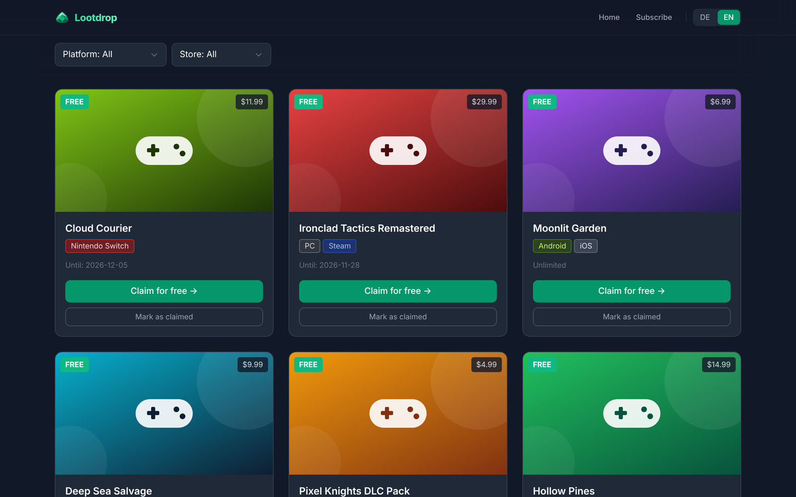
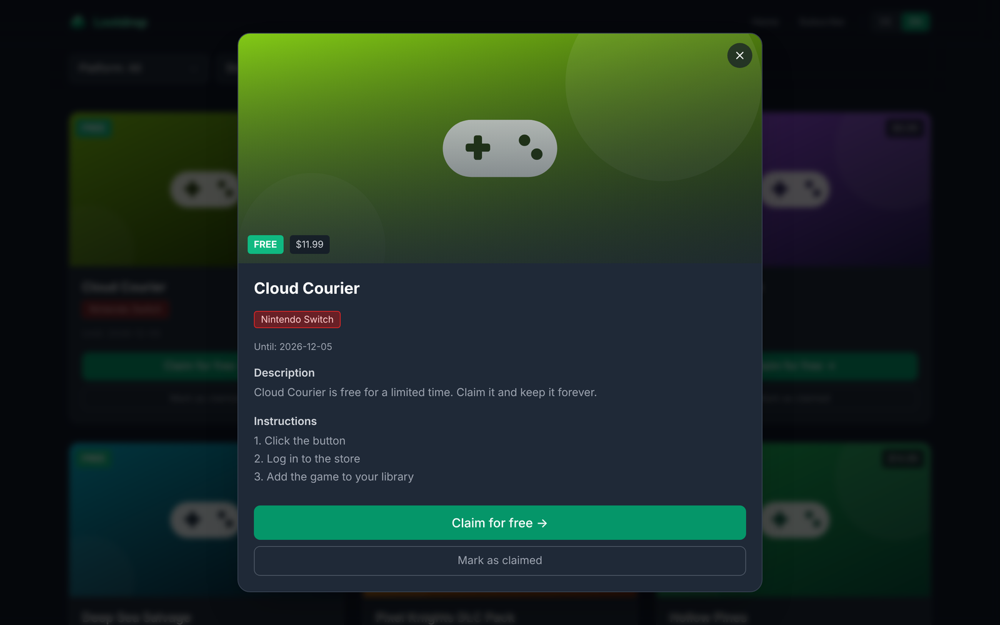
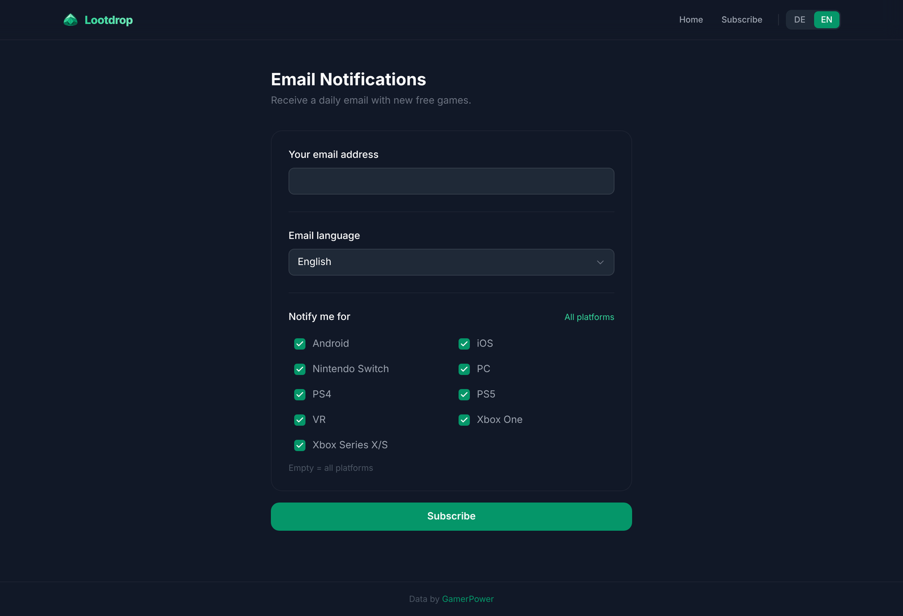
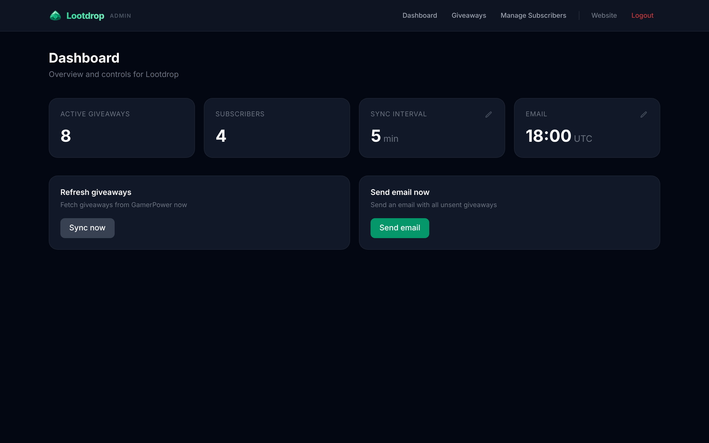
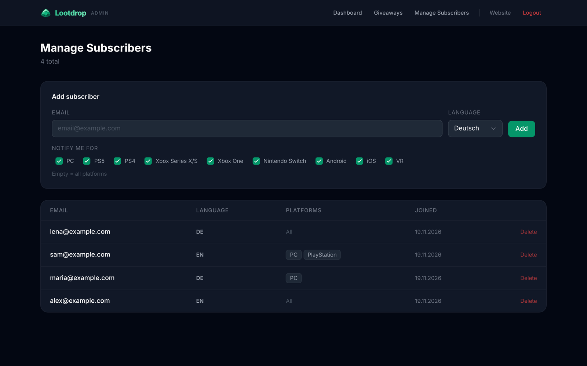

# Lootdrop

Lootdrop collects free game giveaways from the [GamerPower API](https://www.gamerpower.com/api-read) and sends a daily email digest to subscribers. Subscribers choose their platforms and their language (German or English).

## Features

- Automatic giveaway sync from the GamerPower API (interval adjustable in the admin panel, default every 5 minutes)
- Daily email digest with new giveaways (send time adjustable in the admin panel)
- Platform filtering per subscriber
- Two languages: German (`de`) and English (`en`)
- Email preferences page: change language or platforms, or unsubscribe
- Admin panel for giveaways, subscribers and settings

## Screenshots

| Giveaway overview | Giveaway details |
|---|---|
|  |  |
| **Subscribe** | **Admin dashboard** |
|  |  |

<details>
<summary>More: subscriber management</summary>



</details>

The screenshots show demo data. The interface is available in English and German (DE/EN toggle).

## Stack

- **Backend**: FastAPI, SQLModel, APScheduler
- **Database**: SQLite
- **Templates**: Jinja2, Tailwind CSS (CDN)
- **Email**: SMTP

## Quick Start

### Docker (recommended)

A ready-made image is published to the GitHub Container Registry on every release.

1. Create an environment file and fill in your values (at least `ADMIN_PASSWORD`, `SECRET_KEY`, `BASE_URL` and the SMTP settings):
   ```bash
   curl -o .env https://raw.githubusercontent.com/Jeansy91/lootdrop/main/.env.example
   ```

2. Start the container:
   ```bash
   docker run -d --name lootdrop \
     --env-file .env \
     -p 8000:8000 \
     -v ./data:/data \
     --restart unless-stopped \
     ghcr.io/jeansy91/lootdrop:latest
   ```

The app runs on `http://localhost:8000`, the admin panel on `http://localhost:8000/admin`. The SQLite database is stored in `./data/`.

Instead of `latest` you can pin a version, for example `ghcr.io/jeansy91/lootdrop:1.0.0`. All versions are listed under [Releases](https://github.com/Jeansy91/lootdrop/releases).

With Docker Compose:

```yaml
services:
  lootdrop:
    image: ghcr.io/jeansy91/lootdrop:latest
    env_file: .env
    ports:
      - "8000:8000"
    volumes:
      - ./data:/data
    restart: unless-stopped
```

To build the image yourself, run `docker build -t lootdrop .` in the repository.

### Local Development

Requirements: Python 3.12 or newer. CI tests Python 3.12, 3.13, 3.14 and 3.15.

```bash
python -m venv .venv
source .venv/bin/activate
pip install -r requirements.txt
cp .env.example .env
# edit .env, set DATABASE_PATH=./data/lootdrop.db
uvicorn app.main:app --reload
```

Run the tests:

```bash
python -m unittest discover -s tests -v
```

## Configuration

All settings are read from environment variables or from a `.env` file. See [`.env.example`](.env.example) for a template.

| Variable | Description | Default |
|---|---|---|
| `ADMIN_USERNAME` | Admin panel username | `admin` |
| `ADMIN_PASSWORD` | Admin panel password. **Always set a strong password.** | `changeme123` (local development only) |
| `SECRET_KEY` | Secret for signing sessions. **Always set a long random value**, e.g. `python -c "import secrets; print(secrets.token_urlsafe(48))"` | insecure placeholder (local development only) |
| `BASE_URL` | Public URL of your instance, used for links in emails | `http://localhost:8000` |
| `DATABASE_PATH` | Path to the SQLite file | `/data/lootdrop.db` |
| `SMTP_HOST` | SMTP server hostname | `smtp.gmail.com` |
| `SMTP_PORT` | SMTP port | `587` |
| `SMTP_USER` | SMTP username | – |
| `SMTP_PASSWORD` | SMTP password or app password | – |
| `SMTP_FROM_NAME` | Sender display name | `Lootdrop` |
| `SMTP_FROM_EMAIL` | Sender email address | – |
| `SMTP_USE_TLS` | Use STARTTLS (`true`/`false`) | `true` |
| `EMAIL_HOUR` | Initial daily send hour (UTC) | `18` |
| `EMAIL_MINUTE` | Initial daily send minute (UTC) | `0` |

`EMAIL_HOUR` and `EMAIL_MINUTE` only set the starting value. Once you change the send time or the sync interval in the admin panel, the value stored in the database is used.

Never expose an instance to the internet with the default admin password or secret key. See [SECURITY.md](SECURITY.md) for more.

## Admin Panel

Available at `/admin`. Log in with `ADMIN_USERNAME` and `ADMIN_PASSWORD`.

- **Dashboard**: live stats, trigger a sync or an email send manually, change the sync interval and the email send time
- **Giveaways**: browse and delete fetched giveaways, reset their email status
- **Subscribers**: add or remove subscribers manually

## CI, Security and Releases

### Build workflow

`.github/workflows/build-image.yml` runs on every pull request, on every push to `main` and on manual dispatch:

1. Tests on Python 3.12, 3.13, 3.14 and 3.15 (syntax check, template route tests, app import).
2. Security checks from `.github/workflows/security.yml` (see below).
3. Builds the Docker image and starts it once in a container as a smoke test.
4. On `main` only: pushes the image to `ghcr.io/jeansy91/lootdrop` and creates a GitHub release.

### Automatic releases

Every push to `main` with relevant changes creates a new release. The next version is derived from the [Conventional Commits](https://www.conventionalcommits.org/) since the last tag:

| Commits since the last release | Version bump |
|---|---|
| `feat!:`, `fix!:` … or a `BREAKING CHANGE` footer | major |
| `feat:` | minor |
| `fix:`, `chore(deps):` and anything else | patch |
| only `ci:`, `docs:`, `test:`, `style:` or `chore:` (except `chore(deps)`) | no release |

The image is tagged with `latest`, the commit SHA and the version without the `v` (for example `1.2.3`). The release notes are generated by GitHub.

### Dependency updates

Dependabot (`.github/dependabot.yml`) checks Python packages, the Docker base image and the GitHub Actions every Monday. Patch and minor updates are merged automatically once CI passes, which then triggers a new release. Major updates wait for a manual review.

`renovate.json` is only used by the Gitea mirror and has no effect on GitHub.

### Security checks

`.github/workflows/security.yml` runs as part of every build and additionally every Monday:

- `pip-audit` checks `requirements.txt` for known vulnerabilities.
- `bandit` checks the Python code for insecure patterns.
- `gitleaks` scans the whole Git history for committed secrets.

See [SECURITY.md](SECURITY.md) for how to report a vulnerability.

## Project Structure

```
app/
  main.py               # App entry point, middleware, routers
  config.py             # Settings from environment variables
  database.py           # Database engine, tables and migrations
  models.py             # SQLModel database models
  scheduler.py          # Sync and email jobs (APScheduler)
  i18n.py               # Translation strings (de/en)
  routes/
    public.py           # Home page with giveaway list
    subscribe.py        # Subscribe, preferences, unsubscribe
    admin.py            # Admin panel
  services/
    gamerpower.py       # GamerPower API client
    giveaway_service.py # Sync, platform mapping, sent status
    email_service.py    # Daily digest via SMTP
    settings_service.py # Settings stored in the database
  templates/            # Jinja2 templates (public, admin/, email/)
  static/               # Static files
tests/                  # Unit tests
Dockerfile
.env.example
```

## Contributing

Contributions are welcome. Please read [CONTRIBUTING.md](CONTRIBUTING.md) first.

## License

Lootdrop is released under the [MIT License](LICENSE).

## Acknowledgements

Giveaway data is provided by [GamerPower](https://www.gamerpower.com). Lootdrop is not affiliated with GamerPower.
